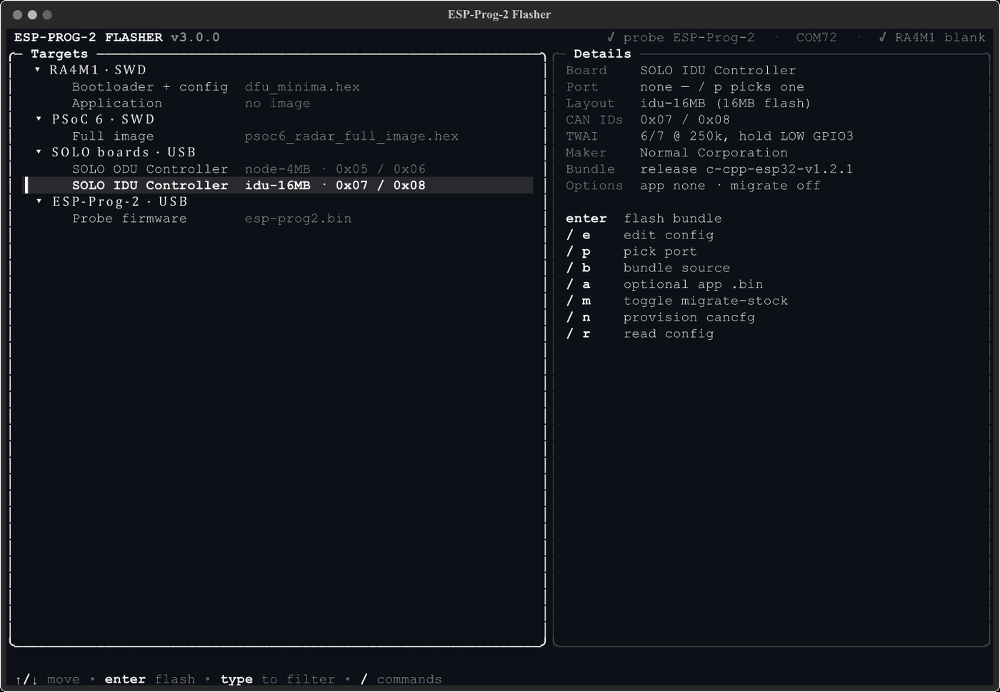
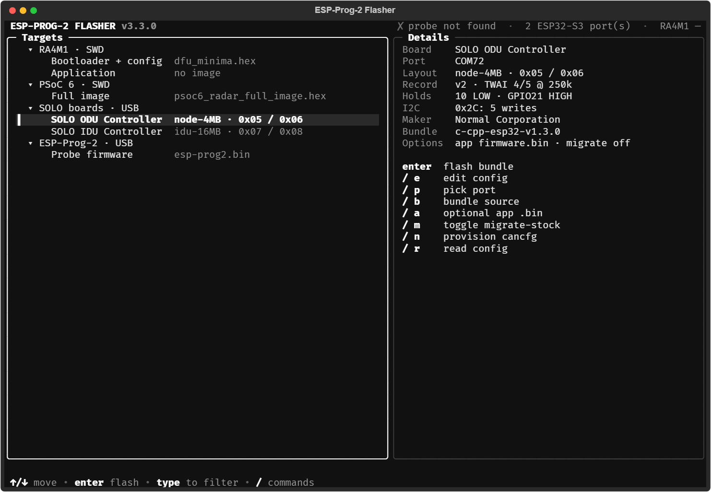
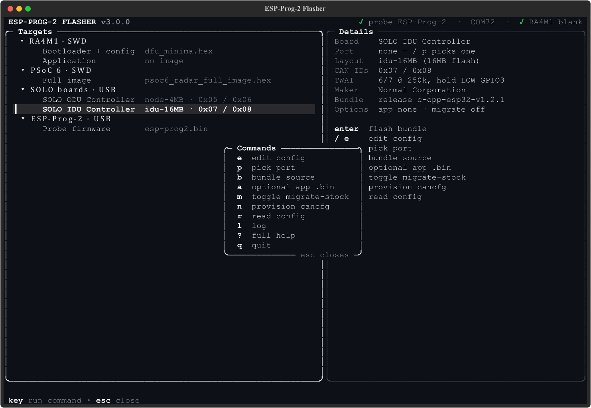
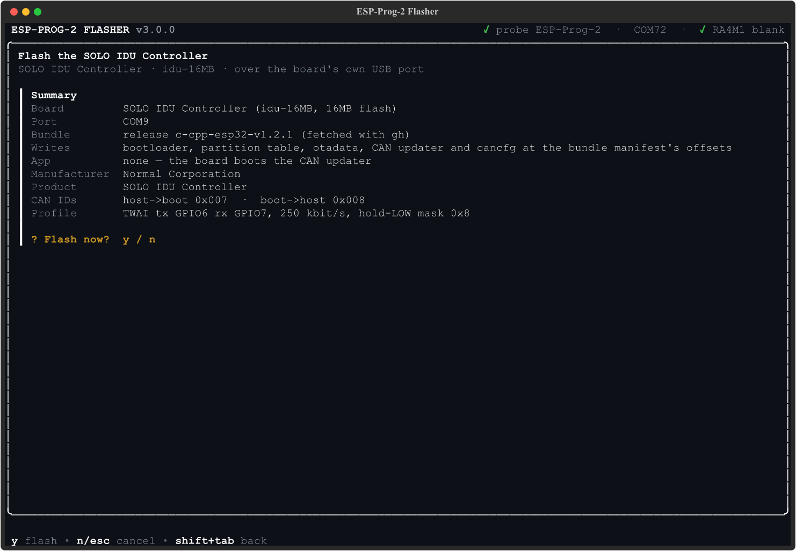
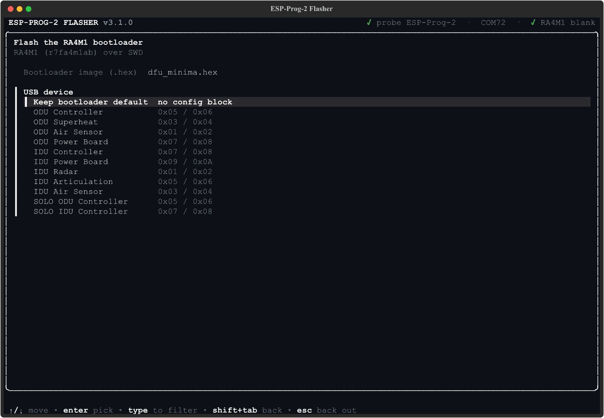

# ESP-Prog-2 Flasher

A `uv`-run Python **TUI/CLI** (v3.0.0) for flashing Normal Corporation's boards. A
keyboard-driven dashboard (or headless flags) covers four jobs:



1. **Flash an RA4M1 bootloader (and application) to a target board** through the
   probe (auto-detects the ESP-Prog-2 on Espressif's USB VID `0x303A`/PID `0x1002`, detects whether the
   target MCU is connected, and programs it with **pyOCD**). It can optionally
   write a **device config block** into the target's data flash (`0x40101C00`) —
   **custom USB DFU manufacturer/product names** the bootloader advertises in DFU
   mode, plus the **per-device bootloader CAN ID pair** (host→boot / boot→host).
   Once the bootloader is in place it can also **flash an application `.bin`**
   (e.g. a PlatformIO/Arduino build) to the target's application region
   (`0x4000`) over SWD — the same image `pio run -t upload` sends over DFU, but
   pushed through the probe. It programs the application region only, leaving the
   bootloader untouched.
2. **Flash the PSoC 6 on the IDU Radar board** — writes the bundled full image
   (bootloader + App1, `hex/psoc6_radar_full_image.hex`) to the PSoC 62S3's main
   flash over SWD with pyOCD. See [PSoC 6 (IDU Radar)](#psoc-6-idu-radar).
3. **Set up a SOLO ODU/IDU board (ESP32-S3)** over the board's **own** USB port —
   writes the Embedded-CAN-Bootloaders bundle plus the board's `cancfg`
   (device config block and board profile) with **esptool**. The same port
   can provision or read just the `cancfg` of an ESP32-S3 CAN node. See
   [SOLO boards](#solo-boards-esp32-s3) and
   [ESP32-S3 CAN node config](#esp32-s3-can-node-config-cli-only).
4. **Reflash the ESP-Prog-2's own firmware** — writes the bundled
   `firmware/esp-prog2.bin` to the probe's ESP32-S3 with **esptool**.

Default target: **Renesas RA4M1 / R7FA4M1AB** (the MCU on an Arduino UNO R4 Minima).
Default target firmware: bundled `hex/dfu_minima.hex` (the stock R4 Minima DFU bootloader).
Default probe firmware: bundled `firmware/esp-prog2.bin` — a **custom esp-usb-bridge
build** (SWD/CMSIS-DAP interface + mass storage disabled). The stock launchpad image is
JTAG-mode with an MSC drive and does **not** work with pyOCD; see
[`firmware/README.md`](firmware/README.md) for the why and the rebuild recipe.

## Install (prebuilt binary)

Standalone binaries for Windows/macOS/Linux are attached to every
[GitHub release](https://github.com/XiaoKChen/ESP-PROG-2-PY-CLI/releases).
The repo is currently **private**, so the installers download through the
[GitHub CLI](https://cli.github.com/) — run `gh auth login` once first.
From a clone of this repo:

```sh
scripts/install.sh        # macOS / Linux → ~/.local/bin/esp-prog2-flasher
```

```powershell
.\scripts\install.ps1     # Windows → %LOCALAPPDATA%\Programs\esp-prog2-flasher (added to user PATH)
```

Both take an optional version (e.g. `scripts/install.sh v1.0.0`,
`.\scripts\install.ps1 -Version v1.0.0`); the default is the latest release.
If `esp-prog2-flasher` is already on your PATH, the scripts report the existing
install and prompt `Replace it? [y/N]` (default: keep). In a non-interactive /
non-TTY shell they skip the prompt and keep the existing install.
Or skip the scripts and grab an asset directly:

```sh
gh release download --repo XiaoKChen/ESP-PROG-2-PY-CLI --pattern esp-prog2-flasher-linux   # or -macos / -windows.exe
```

> If the repo goes public, the scripts fall back to plain
> `curl`/`Invoke-WebRequest` against the release URLs — no `gh` needed.

## Setup

Requires [uv](https://docs.astral.sh/uv/). Everything runs through it — no
manual venv or pip.

```sh
uv sync          # create .venv from uv.lock
```

## Run it

```sh
uv run esp-prog2-flasher          # launch the interactive TUI
```



The TUI is a keyboard-driven dashboard in the style of
[TTSSH](https://github.com/XiaoKChen/TTSSH):

- **Header**: the version, then the probe, the ESP-Prog-2 serial port and the
  last detected RA4M1 state (`✓ probe ESP-Prog-2 · COM72 · ✓ RA4M1 blank`).
- **Targets** (left): a tree of what can be flashed, grouped by chip and link:
  `RA4M1 · SWD` (*Bootloader + config*, *Application*), `PSoC 6 · SWD`
  (*Full image*), `SOLO boards · USB` (one row per preset) and
  `ESP-Prog-2 · USB` (*Probe firmware*). Each row shows its image, or a SOLO
  preset's layout and CAN IDs. `enter`, `→` and `←` fold a group. Below, a
  `── Recent ──` section lists this session's runs, newest first: target,
  port or image, `✓`/`✗` and how long ago. Recents, settings, the selection and
  folded groups are remembered between launches (see
  [Saved state](#saved-state)).
- **Details** (right): the selection's settings (chip, image path, address or
  layout, USB names and CAN IDs, port, TWAI pins and bitrate, detect state,
  last run), then the commands valid for it. Hidden below 80 columns.
- **Status line**: `✓` success, `!` warning, `✗` error, cleared after a few
  seconds; a spinner while a job runs.
- **Footer**: the keys for the current screen.

### Typing and commands

On every list, **typing filters the list**; there are no single-letter action
keys. Any character except `/` goes into the filter shown in the panel title,
`backspace` edits it and `esc` clears it. While filtering, the tree turns into
a flat list of matching targets (with their group) and recents.

**`/` opens the command popup**: a small box listing the commands valid for
the current screen and selection. The next key runs one and closes the popup;
`esc` or a second `/` just closes it, and any other key closes it with a
`no shortcut` message. Dashboard commands (after `/`):

| Key | Command | Offered on |
|---|---|---|
| `d` | detect the chip over SWD (the PSoC 6 row checks the PSoC 6, the others the RA4M1) | RA4M1 rows, PSoC 6 |
| `f` | pick the image file in the file browser | RA4M1 rows, PSoC 6 |
| `e` | edit config: USB device (known, or *Custom…* with its CAN IDs) and manufacturer; on a SOLO row, the manufacturer | RA4M1 bootloader, SOLO |
| `p` | pick the board's own port | SOLO |
| `b` | bundle source: a release tag (fetched with `gh`) or an unzipped bundle folder | SOLO |
| `a` | optional app `.bin` for `ota_0` (SOLO); toggle the Embassy `0x8000` app address (RA4M1 app) | SOLO, RA4M1 app |
| `m` | toggle migrate-from-stock (erase `0x10000`–`0x1FFFF` first) | SOLO |
| `n` | provision the preset's cancfg, like `--provision-node` | SOLO |
| `r` | read the board's config, like `--read-node-config` | SOLO |
| `g` | get Espressif's official (JTAG) probe image, saved beside the bundled build | ESP-Prog-2 |
| `c` | forget the saved state (deletes the file, resets this session to the defaults) | everywhere |
| `l` / `?` / `q` | session log / full help / quit | everywhere |

### Saved state

The TUI remembers its choices between launches in one JSON file per user:
`%APPDATA%\esp-prog2-flasher\state.json` on Windows, otherwise
`$XDG_CONFIG_HOME/esp-prog2-flasher/state.json` (default
`~/.config/esp-prog2-flasher/state.json`).

- **What:** the bootloader, application, PSoC 6 and SOLO settings (images, device
  and names, custom CAN IDs, Embassy, SOLO port, bundle, app, migrate flag), the
  last 10 Recent runs, the selected row, folded groups and, per picker kind
  (`.hex`, app `.bin`, bundle folder), the last 5 files picked, listed under
  `── Recent ──` at the top of the file browser. Nothing sensitive is stored.
- **When:** written atomically after every edit, confirmed run or fold, and on
  quit. Headless flags never read or write it.
- **Bad or moved files:** a saved path that no longer exists falls back to its
  default (the bundled image, or empty) with one `!` status line. A corrupt file
  is ignored with a `!` line and replaced on the next save. A file from a newer
  version, or in an unknown format, is ignored and never overwritten; `/ c`
  deletes it.
- **Opting out:** `/ c` forgets the saved state; `--no-state` skips loading and
  saving it for that launch (tests, CI, kiosk benches).

### Flashing

`enter` on a target runs its **wizard**: one field at a time, prefilled with
the current choice so `enter` accepts it. Completed fields stay listed above
the current one, `shift+tab` steps back and `esc` backs out. Pick-lists
(devices, ports, files) filter as you type, and *Browse…* opens the file
browser.

| Target | The wizard asks |
|---|---|
| RA4M1 bootloader | the `.hex` (bundled `dfu_minima.hex` by default); the USB device: *Keep bootloader default* (no config block), a known device (its CAN IDs are fixed from the board table) or *Custom…* (a name and an optional CAN ID pair, both or neither); the USB manufacturer |
| RA4M1 application | the `.bin`; the base address, `0x4000` (C bootloader) or `0x8000` (Embassy bootloader) |
| PSoC 6 | the `.hex` (the bundled full image by default); see [below](#psoc-6-idu-radar) |
| SOLO board | the board's own port, picked from the detected ports (the ESP-Prog-2 bridge is marked as not a SOLO board) or typed; the bundle source. The app, migrate flag and manufacturer come from `/ a`, `/ m` and `/ e` |
| ESP-Prog-2 | nothing: the bundled `esp-prog2.bin` goes to the ESP-Prog-2's serial port |

The RA4M1 rows need a Detect that found the RA4M1; one runs at start-up and
`/ d` repeats it.



**Every flash, erase or provision asks first.** The wizard ends on a summary:
the chip or board, the image(s), the address range or layout and, for config
writes, the manufacturer, product and CAN IDs. **`y`** starts the write,
**`n`** or **`esc`** cancels. Reading a config, detecting and downloading the
official image never ask. A running job shows a spinner, a progress bar and
its log; `esc` goes back to the dashboard while it keeps running, and no
other write starts until it finishes. When it ends, the result shows in the
status line and under Recent; `/ l` shows the whole session log.



### Keybindings

The TUI shows the same table with `/` `?`.

| Where | Key | Action |
|---|---|---|
| Every list | `↑`/`↓`, `pgup`/`pgdn`, `home`/`end` | move |
| | any character except `/` | filter the list |
| | `backspace` | edit the filter |
| | `esc` | clear the filter, or go back one screen |
| | `/` | open the command popup (`esc` or `/` closes it) |
| | `ctrl+c` / `ctrl+q` | quit (works everywhere) |
| | `/` `l` / `/` `?` / `/` `q` | session log / full help / quit |
| Dashboard | `enter` | run the target's wizard, fold a group, or rerun a recent run |
| | `→` / `←` | expand / collapse a group; `←` on a target selects its group |
| | `/` `d` `f` `e` `p` `b` `a` `m` `n` `r` `g` | the commands above |
| Wizard | `enter` | accept the field (or the highlighted choice) and go on |
| | `shift+tab` | previous field |
| | `esc` | back out to where the wizard started |
| y/n questions | `y` / `n` or `esc` | start the write / cancel |
| Run view | `esc` | back to the dashboard; the job keeps running |
| Folder browser | `enter` | open the folder, or pick the file |
| | `←` or `backspace` on an empty filter | parent folder (a drive list at a Windows drive root) |
| | `/` `.` | use this folder (when picking a folder) |
| | `/` `t` | type a path (`~` is expanded) |
| Log, help | `↑`/`↓`, `pgup`/`pgdn` | scroll |
| | `esc` | back |

In text fields every key, `/` included, is typed literally.



### Headless / scripting

```sh
uv run esp-prog2-flasher --list             # list connected probes + serial ports
uv run esp-prog2-flasher --detect           # print probe+target status, exit
uv run esp-prog2-flasher --flash            # flash the RA4M1 bootloader (bundled hex)
uv run esp-prog2-flasher --flash --hex path/to/other.hex
uv run esp-prog2-flasher --flash --product "IDU Controller"                 # also write the device config block
uv run esp-prog2-flasher --flash --product "IDU Controller" --manufacturer "Acme"
uv run esp-prog2-flasher --flash --product "My Custom Board" --boot-cmd-id 0x700 --boot-reply-id 0x701

uv run esp-prog2-flasher --flash-app path/to/firmware.bin        # flash an app .bin to the RA4M1 app region (0x4000)
uv run esp-prog2-flasher --flash-app path/to/firmware.bin --app-address 0x4000   # override the base address

uv run esp-prog2-flasher --detect --psoc6   # detect a PSoC 6 target (IDU Radar) instead of the RA4M1
uv run esp-prog2-flasher --flash-psoc6      # flash the PSoC 6 with the bundled hex (bootloader + App1)
uv run esp-prog2-flasher --flash-psoc6 --hex path/to/psoc6.hex

uv run esp-prog2-flasher --flash-probe       # flash the bundled SWD firmware (needs download mode)
uv run esp-prog2-flasher --flash-probe --port COM110   # required when only a download-mode port is present
uv run esp-prog2-flasher --flash-probe --probe-bin path/to/other.bin
uv run esp-prog2-flasher --update-probe-fw   # fetch official JTAG image as esp-prog2-official-jtag.bin (reference)

uv run esp-prog2-flasher --provision-node --port COM7 --product "IDU Radar"   # ESP32-S3 CAN node config (see below)
uv run esp-prog2-flasher --read-node-config --port COM7

uv run esp-prog2-flasher --flash-solo idu --port COM7 --bundle path/to/bundle   # SOLO board (see below)
```

`--freq <hz>` overrides the SWD clock for target flashing (default 1 MHz).
`--no-state` (TUI only) skips loading and saving the [saved state](#saved-state).
`--flash-probe` without `--port` only auto-detects the running bridge
(`303A:1002`). Every ESP32-S3 on USB-Serial-JTAG, a SOLO board included, shows
up as `303A:1001`, which may be the ESP-Prog-2 in download mode or a SOLO board,
so when only such ports exist it exits `2`, lists them and asks for `--port`.
`--list` labels them `ESP32-S3 download mode — ESP-Prog-2 or a SOLO board`. The
TUI's probe flash likewise makes you pick the port from the list (nothing is
preselected) and the header never calls a `303A:1001` port the ESP-Prog-2.
`--detect` exit codes: `0` target/probe OK, `2` no probe found.

`--product DEVICE` writes the device config block alongside the bootloader flash.
`--manufacturer NAME` sets the manufacturer string (max 32 ASCII chars, default
`Normal Corporation`) and only takes effect when a `--product` is given. Omit
`--product` and, on an interactive terminal, `--flash` prompts you to pick a
device (or skip); non-interactively it writes no block and the bootloader keeps
its compiled-in defaults.

A **known device** (from the list below) has its boot CAN ID pair fixed from the
board table — passing `--boot-cmd-id`/`--boot-reply-id` for one is rejected. Any
other `--product` value is a **custom device** whose CAN IDs you may set with
`--boot-cmd-id ID` and `--boot-reply-id ID` (given together; hex like `0x700` or
decimal, `0x000..0x7FF`). Omit both to keep the bootloader defaults
(`0x79E`/`0x79F`). Known `--product` values:

- `ODU Controller`, `ODU Superheat`, `ODU Air Sensor`, `ODU Power Board`
- `IDU Controller`, `IDU Power Board`, `IDU Radar`, `IDU Articulation`, `IDU Air Sensor`
- `SOLO ODU Controller`, `SOLO IDU Controller` (the SOLO presets; see
  [SOLO boards](#solo-boards-esp32-s3))

## PSoC 6 (IDU Radar)

The IDU Radar board's PSoC 62S3 (CY8C6245) is flashed over SWD through the same
ESP-Prog-2 using pyOCD's built-in `cy8c6xx5` target (no CMSIS pack needed).

- **CLI:** `--detect --psoc6` to check the link, `--flash-psoc6` to flash
  (`--hex PATH` overrides the bundled image, `--freq` sets the SWD clock).
- **TUI:** `enter` on *PSoC 6 · SWD › Full image* flashes the bundled hex or one
  picked with `/ f`. It is not gated on detection; `/ d` on that row checks the
  PSoC 6 link first (like `--detect --psoc6`).
- **Wiring (3.3 V target):** probe SWDIO, SWCLK, GND and VTref to the board's SWD
  header; also XRES if the header exposes it.
- **Image:** `hex/psoc6_radar_full_image.hex` is `full_image.hex` (bootloader + App1)
  from the [PSOC6-Dual-Radar v2.0.1 release](https://github.com/XiaoKChen/PSOC6-Dual-Radar/releases/tag/v2.0.1).
- **Safety:** only data inside main flash (`0x10000000`-`0x10080000`) is written.
  Cypress metadata pseudo-sections (`0x90xxxxxx`) are dropped; any other
  out-of-range data (e.g. SFLASH, eFuse) aborts the flash before touching hardware.

## ESP32-S3 CAN node config (CLI only)

ESP32-S3 CAN nodes running `node_updater` read the same 80-byte device config
block as the RA4M1 bootloader (manufacturer, product name, boot CAN ID pair)
from their `cancfg` data partition. This is written with esptool over the
**node's own** serial/USB download port, not through the ESP-Prog-2, so
`--port` is required and never auto-detected.

```sh
# Known device: CAN IDs come from the board table.
uv run esp-prog2-flasher --provision-node --port COM7 --product "IDU Radar"
# Custom device with its own CAN ID pair.
uv run esp-prog2-flasher --provision-node --port COM7 --product "My Node" --boot-cmd-id 0x700 --boot-reply-id 0x711
# Read back and decode what the node will use.
uv run esp-prog2-flasher --read-node-config --port COM7
```

- `--provision-node` needs `--product` and takes `--manufacturer`,
  `--boot-cmd-id` and `--boot-reply-id` with the same rules as `--flash`. It
  writes the block, reads it back and fails if any byte differs.
- The `cancfg` offset comes from the node's partition table at `0x8000`.
  With no valid table there (e.g. blank flash) it falls back to `0x11000`. A
  valid table without a `cancfg` partition is an error, because the node
  firmware would never read a block written anywhere else.
- `--read-node-config` prints the manufacturer, product and CAN IDs, or
  `unprovisioned/invalid (node uses defaults 0x79E/0x79F)`. It also reads the
  24-byte board-profile record at `cancfg + 0x50` in the same flash read and prints
  `Board profile: TWAI tx GPIO4 rx GPIO5, 250 kbit/s, hold-LOW mask 0x0`, or
  `Board profile: no board profile (updater defaults: TWAI tx GPIO4 rx GPIO5, 250 kbit/s, hold-LOW mask 0x0)`
  when the record is absent or invalid. The TUI's `/ r` shows the same.

## SOLO boards (ESP32-S3)

`--flash-solo` sets up a SOLO board in one run, over the **board's own** USB
port. It writes the Embedded-CAN-Bootloaders "one updater" release bundle
(`esp32s3-can-updater-<version>.zip`: one bootloader and CAN updater for every
board, a partition table per flash layout, `manifest.json`) plus the board's
`cancfg`. `--port` is required and never auto-detected.

`cancfg` (`0x11000`, 4 KB) holds the 80-byte v2 device config block (name and
CAN ID pair), then at `+0x50` a 24-byte **board-profile record** (TWAI TX/RX
GPIOs, CAN bitrate, GPIOs to hold LOW at boot), then `0xFF`. Older readers
only read the first 80 bytes. If the record is missing or invalid, the updater
falls back to TX 4, RX 5, 250 kbit/s and no holds.

| Board | Preset (`--product`) | Layout | Flash | TWAI TX/RX | Bitrate | Hold LOW | CAN IDs |
|---|---|---|---|---|---|---|---|
| `odu` | `SOLO ODU Controller` | `node-4MB` | 4 MB | 4 / 5 | 250k | none | `0x05`/`0x06` |
| `idu` | `SOLO IDU Controller` | `idu-16MB` | 16 MB | 6 / 7 | 250k | GPIO3 | `0x07`/`0x08` |

```sh
# Fetch the bundle from the default release (c-cpp-esp32-v1.2.1) with gh, then flash.
uv run esp-prog2-flasher --flash-solo odu --port COM7
# Use an unzipped bundle on disk, or another release.
uv run esp-prog2-flasher --flash-solo idu --port COM8 --bundle path/to/esp32s3-can-updater-1.2.1
uv run esp-prog2-flasher --flash-solo idu --port COM8 --bundle-tag c-cpp-esp32-vX.Y.Z
# Also install an app in ota_0; erase a stock Arduino layout's leftovers first.
uv run esp-prog2-flasher --flash-solo odu --port COM7 --bundle bundle/ --app firmware.bin --migrate-stock
# Omit the board on a terminal to pick it from a prompt.
uv run esp-prog2-flasher --flash-solo --port COM7 --bundle bundle/
```

Flash sequence, each step one esptool run:

1. With `--migrate-stock`: erase `0x10000..0x1FFFF`.
2. One `write-flash --flash-mode dio --flash-freq 80m --flash-size <layout>`:
   bootloader at `0x0`, the layout's partition table at `0x8000`, blank
   otadata at `0xE000`, the CAN updater at the layout's `factory` offset
   (`0x20000` on node-4MB, `0xFA0000` on idu-16MB), and `cancfg` at `0x11000`.
3. Read `cancfg` back and fail if any byte differs.
4. With `--app`: write it at the layout's `ota_0` (`0x80000` on node-4MB,
   `0x20000` on idu-16MB) plus an otadata image selecting `ota_0`. Without
   `--app` the board boots the CAN updater.

Every step runs with `--after no-reset`. A final `chip-id` call with
`--before no-reset --after watchdog-reset` then reboots the board, because the
RTS hard reset does not reboot the chip over USB-Serial-JTAG. The USB port
vanishes as the chip resets, so esptool exits non-zero there; the tool ignores
that exit code and logs "board rebooted (the USB port re-enumerates)". The manifest (format 1, esp32s3, dio/80m, `cancfg` at
`0x11000`), the app image and the device names are all checked before esptool
first runs.

- Preset CAN IDs are fixed: `--boot-cmd-id`/`--boot-reply-id` and `--product`
  are rejected. `--manufacturer` works as for `--flash`.
- `--bundle-tag` needs the [GitHub CLI](https://cli.github.com/) (`gh auth
  login`). A tag that is not published yet fails with a clear "not found"
  error; pass `--bundle` instead.
- **TUI:** each preset is a row under *SOLO boards · USB*; `enter` on it does the
  same. The wizard asks for the board's own port (picked from the detected ports,
  where the ESP-Prog-2's bridge port is marked as not a SOLO board, or typed) and
  the bundle source (the release tag or a local unzipped folder). The optional app
  `.bin` (`/ a`), migrate-stock (`/ m`) and manufacturer (`/ e`) are set from the
  dashboard and shown in the summary. `/ n` writes only the preset's cancfg like
  `--provision-node`; `/ r` shows the decoded block or "unprovisioned" like
  `--read-node-config`.

## What it does

1. **Auto-detect the ESP-Prog-2** — enumerates CMSIS-DAP probes and picks the one
   identifying as Espressif/ESP-Prog (falls back to the first CMSIS-DAP probe).
2. **Detect the target** — opens an SWD session against `r7fa4m1ab` and examines
   the Cortex-M core. Reports one of: *no probe* / *probe but no target* /
   *RA4M1 connected* / *RA4M1 connected (blank flash)*. A blank chip reads
   `pc=0xfffffffe` after reset — still flashable. `--detect --psoc6` does the
   same against `cy8c6xx5` (PSoC 6).
3. **Flash target** — programs the selected `.hex` via pyOCD's `FileProgrammer`
   (equivalent to `pyocd flash -t r7fa4m1ab <hex>`), shows progress, then resets
   the target. If a device was given, it also writes the encoded config block
   (DFU names + boot CAN ID pair) to the target's data flash (`0x40101C00`)
   before the reset.
4. **Flash application** — programs an app `.bin` at the application base address
   (`0x4000` by default, overridable) via pyOCD's `FileProgrammer`, then resets.
   A `.bin` carries no load address, so the base address is supplied explicitly;
   only the pages the image touches are sector-erased, so the bootloader region
   below it is left intact.
5. **Flash PSoC 6** — loads the `.hex`, keeps only the segments inside PSoC 6
   main flash (see [Safety](#psoc-6-idu-radar)), programs them against pyOCD's
   built-in `cy8c6xx5` target via `FlashLoader`, then resets.
6. **Flash ESP-Prog-2** — writes `firmware/esp-prog2.bin` to the ESP32-S3 with
   esptool (`write-flash 0x0`). Requires the board in ROM download mode (hold
   BOOT, tap RESET) — see [`firmware/README.md`](firmware/README.md).
7. **Flash a SOLO board** — see [SOLO boards](#solo-boards-esp32-s3).

## Layout

```
ESP-PROG-2-PY-CLI/
├── src/esp_prog2_flasher/
│   ├── flasher.py     # pyOCD (target) + esptool (probe) logic — no UI deps
│   ├── dfu_config.py  # encode the device config block (DFU names + boot CAN IDs)
│   ├── board_profile.py  # ESP32-S3 board-profile record, cancfg image, SOLO presets
│   ├── app.py         # Textual TUI: session state, "/" commands, flasher jobs
│   ├── tui/           # TUI: theme, dashboard, "/" popup, wizards, file browser
│   ├── cli.py         # argparse entry point (TUI by default)
│   └── __main__.py    # `python -m esp_prog2_flasher`
├── hex/             # bundled dfu_minima.hex (RA4M1 bootloader) + psoc6_radar_full_image.hex; override with --hex
├── firmware/        # bundled esp-prog2.bin (ESP-Prog-2's own firmware) + README
├── tools/           # pyOCD config + notes on flashing prerequisites
├── packs/           # slim Renesas RA_DFP pack so r7fa4m1ab resolves offline
├── scripts/         # build.* (PyInstaller), install.* (release installers), run-termux.sh
├── tests/           # pytest suite
├── docs/images/     # README screenshots + demo GIF
├── esp-prog2-flasher.spec   # PyInstaller spec (bundles hex/ + firmware/)
└── pyproject.toml
```

## Notes

- The target **must be flashed with pyOCD, not OpenOCD** — the installed OpenOCD
  build lacks the `renesas_ra` flash driver. See [`tools/README.md`](tools/README.md).
- Reflashing the **probe** needs it in ROM download mode (hold BOOT, tap RESET)
  and uses esptool — see [`firmware/README.md`](firmware/README.md).
- pyOCD only accepts a CMSIS-DAPv2 interface whose USB **subclass is 0**. The
  stock esp-usb-bridge advertises subclass `0xFF` (its esp_usb_jtag id), so the
  bundled firmware is built with the interface subclass forced to `0` — without
  that, the probe enumerates but pyOCD reports "no probe."
- The `r7fa4m1ab` device pack ships bundled (`packs/`), so flashing works
  offline with no `pyocd pack install` step. In a bare source checkout the
  bundled pack is still found via `find_default_pack()`; if it is ever missing,
  pyOCD falls back to the pack in the user's cmsis-pack-manager cache.

## Development

```sh
uv run ruff check src/      # lint
uv run ruff format src/     # format
uv run pytest               # tests (tests/)
uv run mypy src/            # type check (strict)
uv add <pkg>                # add a dependency (--dev for tooling)
```

Python version: pinned in `.python-version` / `pyproject.toml`.

### Standalone binary

A one-file executable (no Python install required to run it) can be built with
PyInstaller:

```sh
uv run pyinstaller esp-prog2-flasher.spec --noconfirm   # or scripts/build.ps1 / scripts/build.sh
```

Produces `dist/esp-prog2-flasher.exe` (Windows) or `dist/esp-prog2-flasher`
(macOS/Linux). The bundled `hex/` and `firmware/` files are packed into the
binary. GitHub Actions (`.github/workflows/build.yml`) builds all three
platforms on every push and attaches them to the GitHub release on `v*` tags.

The bundled `hex/`, `firmware/`, and `packs/` files are packed into the binary,
including the slim `r7fa4m1ab` CMSIS device pack — so a fresh machine with no
Python, no pyOCD, and no network can flash the RA4M1 out of the box (no
`pyocd pack install` step). See [`packs/README.md`](packs/README.md).

## Dependencies

All declared in `pyproject.toml`, resolved by uv:

- **pyocd** — SWD/CMSIS-DAP flashing of the RA4M1 and PSoC 6 targets through the probe.
- **esptool** — reflashing the ESP-Prog-2's own ESP32-S3 firmware.
- **pyserial** — serial-port enumeration for probe auto-detection.
- **textual** — the interactive TUI.
- **truststore** — system CA trust for the official-firmware download.
